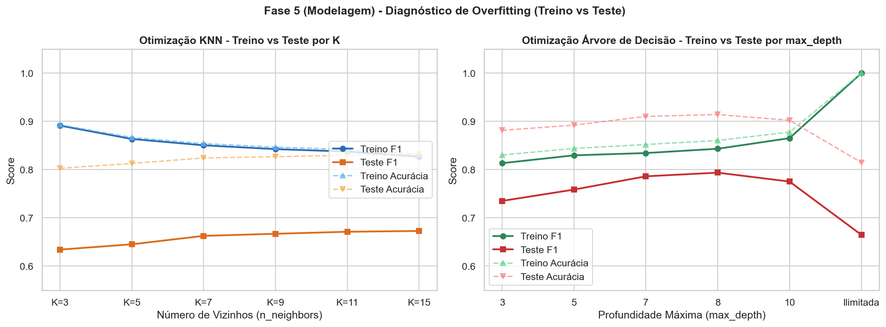
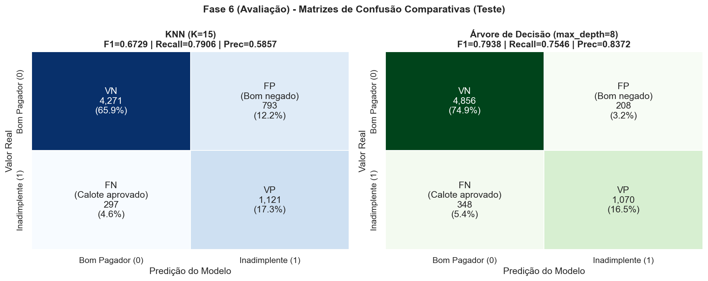
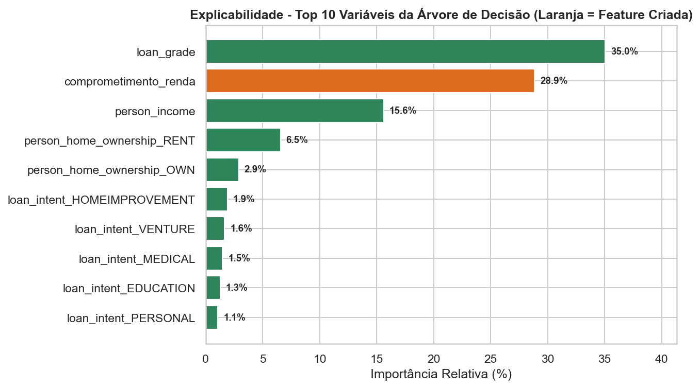
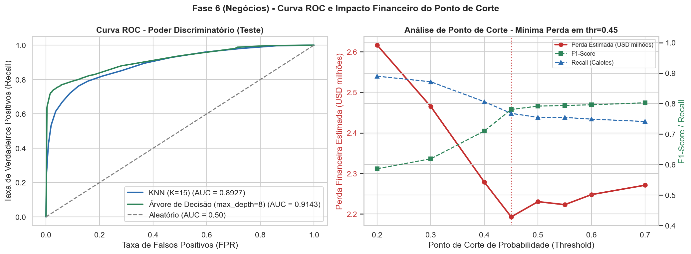

# Pipeline Preditivo de Risco de Crédito (Opção A)

Projeto avaliativo da disciplina **Machine Learning e Visão Computacional** (SENAI/SC - SCTEC).  
Desenvolvimento completo de um pipeline de classificação de risco de crédito: análise exploratória (EDA), limpeza de dados, engenharia de atributos, preparação sem vazamento de dados (*Data Leakage*), validação cruzada 5-Fold, controle de *overfitting* (**KNN** vs **Árvore de Decisão**), análise de ponto de corte (*threshold*) e recomendação final para a diretoria.

---

## 1. Problema de Negócio

Um banco precisa estimar, antes de aprovar o crédito, se o cliente tem risco de se tornar **inadimplente (`loan_status = 1`)** ou se **pagará o empréstimo em dia (`loan_status = 0`)**.

- **Falso Negativo (FN - Calote Aprovado):** o banco libera o dinheiro para um mau pagador, assumindo perda direta do capital (*Loss Given Default*), provisão contábil e custos de cobrança.
- **Falso Positivo (FP - Bom Pagador Negado):** o banco recusa um cliente bom pagador, perdendo receita de juros (custo de oportunidade) e desgastando o relacionamento comercial.

---

## 2. Dicionário de Dados Atualizado

Base original: `credit_risk_dataset.csv` (`32.581` linhas brutas; `32.409` após a limpeza).

| Variável | Tipo | Origem | Descrição |
| :--- | :--- | :--- | :--- |
| `person_age` | `int64` | Original | Idade do solicitante em anos (anomalias `> 100` removidas). |
| `person_income` | `float64` | Original | Renda anual declarada em USD (limitada no P99 = US\$ 225.000). |
| `person_home_ownership` | `object` | Original | Situação de moradia (`RENT`, `MORTGAGE`, `OWN`, `OTHER`). |
| `person_emp_length` | `float64` | Original | Tempo de emprego em anos (anomalias `> 60` removidas; nulos preenchidos com a **mediana = 4,0**). |
| `loan_intent` | `object` | Original | Finalidade do empréstimo (`EDUCATION`, `MEDICAL`, `VENTURE`, `PERSONAL`, `DEBTCONSOLIDATION`, `HOMEIMPROVEMENT`). |
| `loan_grade` | `object` | Original | Classificação interna de risco de crédito (`A` = menor risco até `G` = maior risco). |
| `loan_amnt` | `int64` | Original | Valor solicitado do empréstimo em USD. |
| `loan_int_rate` | `float64` | Original | Taxa anual de juros em % (nulos preenchidos com a **média = 11,02%**). |
| `loan_status` | `int64` | **Alvo (`y`)** | Status do crédito: `0` = Em dia (Bom Pagador), `1` = Inadimplente (Calote). |
| `loan_percent_income` | `float64` | Original | Razão arredondada entre valor do empréstimo e renda (`0.00` a `0.83`). |
| `cb_person_default_on_file` | `object` | Original | Histórico anterior de inadimplência registrado (`Y` / `N`). |
| `cb_person_cred_hist_length` | `int64` | Original | Tempo de histórico de crédito do cliente em anos. |
| **`comprometimento_renda`** | **`float64`** | **Calculada (Fase 3)** | **Nova coluna criada:** `(loan_amnt / person_income) * 100`. Calcula o percentual exato da renda anual comprometido pelo empréstimo, gerada após tratar nulos e validar divisor positivo. |

---

## 3. Resumo Executivo para a Diretoria

### Principais Insights da EDA e Preparação dos Dados
1. **Desbalanceamento da carteira:** `78,18%` de bons pagadores (`25.473`) contra `21,82%` de inadimplentes (`7.108`). Foi aplicado split estratificado (`80/20`) e comparadas duas técnicas de balanceamento via **validação cruzada 5-Fold sem vazamento**: o `RandomUnderSampler` superou o `SMOTE` na Árvore (`F1 = 0,7863 +/- 0,0065` vs `0,7188 +/- 0,0363`, com `5,6x` menos variância) por trabalhar somente com registros reais sem gerar ruído sintético nas colunas One-Hot. O conjunto de teste (`6.482` clientes) ficou 100% intocado.
2. **Limpeza de registros inválidos:** removidos `165` registros duplicados e `7` erros evidentes de cadastro (`5` clientes com `123` a `144` anos, incluindo um registro com renda de US\$ 6 milhões, e `2` clientes de `21` e `22` anos com `123` anos de emprego).
3. **Imputação de nulos justificada pela distribuição:** `person_emp_length` (`887` nulos, assimetria `+2,61`) recebeu a **Mediana (`4,0` anos)**; `loan_int_rate` (`3.094` nulos, assimetria `+0,21`, praticamente simétrica) recebeu a **Média (`11,02%`)**.
4. **Outliers e Escalonamento por algoritmo:** aplicado clipping no percentil 99 em `person_income` (US\$ 225.000) e `StandardScaler` apenas nas 8 variáveis contínuas usadas pelo **KNN** (`fit_transform` no treino balanceado, `transform` no teste). A **Árvore de Decisão** foi treinada **sem escalonamento**, pois realiza cortes monotônicos independentes da unidade de medida.
5. **Impacto da Engenharia de Atributos:** a coluna `comprometimento_renda` apresentou correlação de `+0,3863` com inadimplência e ficou como a **2ª variável mais importante da Árvore vencedora (`28,9%`)**, atrás apenas de `loan_grade` (`35,0%`).

### Combate ao Overfitting e Comparação Final (Teste - 6.482 clientes)

| Modelo Selecionado | Acurácia (Treino / Teste) | F1-Score (Treino / Teste) | Gap F1 | Precisão | Recall | ROC-AUC | FP (Bons Negados) | FN (Calotes) |
| :--- | :---: | :---: | :---: | :---: | :---: | :---: | :---: | :---: |
| **KNN (`K = 15`, escalonado)** | `83,17%` / `83,18%` | `0,8269` / `0,6729` | `0,1540` | `58,57%` | `79,06%` | `0,8927` | `793` (`15,66%`) | `297` (`20,94%`) |
| **Árvore (`max_depth = 8`, sem escala)** | `86,05%` / **`91,42%`** | `0,8433` / **`0,7938`** | **`0,0495`** | **`83,72%`** | `75,46%` | **`0,9143`** | **`208` (`4,11%`)** | `348` (`24,54%`) |

*Diagnóstico de Overfitting:* a Árvore sem limite (`max_depth = None`, profundidade `30`, `1.357` folhas) decorou `100,00%` do treino (`gap_f1 = 0,3352`) e caiu para `81,49%` de acurácia (`F1 = 0,6648`) no teste. Ao limitar a profundidade para `max_depth = 8` (`75` folhas), o modelo atingiu a melhor generalização (`91,42%` de acurácia, `F1 = 0,7938`, `gap_f1 = 0,0495`). No KNN, `K = 3` apresentou o maior sobreajuste (`train_f1 = 0,8913` vs `test_f1 = 0,6342`), enquanto `K = 15` trouxe o melhor resultado no teste (`F1 = 0,6729`).









### Veredito Final para Produção
**Recomendação: colocar em produção a Árvore de Decisão (`max_depth = 8`), com ponto de corte calibrado em `threshold = 0,45`.**

- **Desempenho geral e estabilidade:** supera o KNN em F1-Score (`+12,1 p.p.`), Precisão (`+25,2 p.p.`), Acurácia (`+8,2 p.p.`), ROC-AUC (`0,9143` vs `0,8927`), 5-Fold CV (`0,7863 +/- 0,0065` vs `0,6607 +/- 0,0037`) e apresenta menor overfitting (`gap_f1 = 0,0495`).
- **Impacto financeiro e ponto de corte:** no corte padrão, evita recusar **585 bons pagadores** a mais que o KNN (`208` vs `793` FPs), reduzindo a perda estimada em **~US\$ 325 mil** na carteira de teste (`LGD = 60%`, juros médios de `11,02%` a.a.). Ajustando o *threshold* para **`0,45`**, o Recall sobe para `76,80%` (`19` calotes adicionais bloqueados) e a perda estimada atinge o menor patamar de **US\$ 2,19 milhões** (**~US\$ 355 mil a menos que o KNN**).
- **Operação e auditoria:** decide em até `8` comparações lógicas e produz regras fáceis de explicar para clientes, diretoria e auditoria bancária.

---

## 4. Estrutura do Projeto

```text
├── data/
│   └── raw/credit_risk_dataset.csv          # Base Opção A (Risco de Crédito)
├── notebooks/
│   └── pipeline_risco_credito.ipynb         # Notebook completo executado (Fases 1 a 6)
├── reports/
│   └── figures/                             # 8 gráficos gerados pela execução
├── src/
│   ├── config.py                            # Parâmetros e caminhos via .env
│   ├── data_prep.py                         # Fases 1, 2 e 3 (EDA, limpeza e feature engineering)
│   ├── preprocessing.py                     # Fase 4 (encoding, split estratificado, RUS/SMOTE e scaler)
│   ├── modeling.py                          # Fases 5 e 6 (CV 5-Fold, grids KNN/Árvore, FI, threshold e avaliação)
│   ├── plots.py                             # 8 visualizações padronizadas
│   └── run_pipeline.py                      # Execução CLI completa do pipeline
├── tests/
│   └── test_pipeline.py                     # 17 testes automatizados (dados, anti-leakage, CV, threshold e plots)
├── .env.example                             # Variáveis de ambiente de referência
├── .gitignore                               # Arquivos ignorados pelo Git
├── EXECUTAR TUDO.bat                        # Script Windows (pipeline + testes + Jupyter)
└── requirements.txt                         # Dependências Python
```

---

## 5. Como Executar

### Opção 1 - Execução automática no Windows (`EXECUTAR TUDO.bat`)
Com o ambiente `.venv` criado e dependências instaladas (`python -m venv .venv && .venv\Scripts\pip install -r requirements.txt`), dê **duplo clique** em `EXECUTAR TUDO.bat` na raiz do projeto. O script executa em sequência:
1. Pipeline completo (`src.run_pipeline`), imprimindo todas as métricas e gerando os 8 gráficos em `reports/figures/`.
2. Suíte de `17` testes automatizados (`pytest -v`).
3. Abertura do notebook `notebooks/pipeline_risco_credito.ipynb` no Jupyter (`Ctrl+C` 2x no terminal para encerrar).

Para rodar apenas pipeline + testes sem abrir o navegador:
```powershell
"EXECUTAR TUDO.bat" --sem-jupyter
```

### Opção 2 - Execução manual passo a passo
```bash
# 1. Criar ambiente virtual e instalar dependências
python -m venv .venv
.venv\Scripts\activate
pip install -r requirements.txt

# 2. (Opcional) Configurar variáveis locais a partir do modelo
copy .env.example .env

# 3. Executar pipeline completo via CLI (gera 8 gráficos e imprime métricas)
python -m src.run_pipeline

# 4. Rodar suíte de 17 testes automatizados
pytest -v

# 5. Abrir notebook completo com todas as justificativas e gráficos
jupyter notebook notebooks/pipeline_risco_credito.ipynb
```
